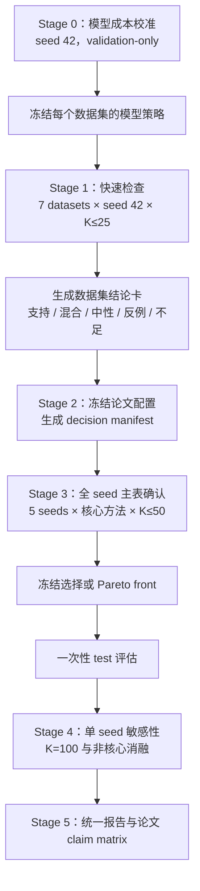

# ICOMP 2026 多保真实验架构设计

> 项目：MinPPI-MOFS  
> 目标会议：ICOMP 2026  
> 截止日期：2026-08-05  
> 设计日期：2026-07-28  
> 运行资源：1 张 GPU，可连续运行  
> 文档状态：48 小时修订进行中；参数等待 seed-42 decision 实测冻结  
> Git：本文档及后续修改由用户自行提交，本任务不执行 Git 提交

---

## 0. 2026-07-28 的 48 小时硬约束修订

本节优先级高于文档后文仍出现的旧 `K=50 × 5 seeds` 默认方案。最终系统
必须能够从空结果开始，在一张 GPU 上于 48 小时内完成可写入论文的完整
证据链。ISOLET K=2/5 的实测已经证明：

- random K=5：985 physical fits，约 57 分钟；
- guided K=5 成本与 random 基本相同；
- K=5 完整 bundle 约 110–115 分钟；
- 成本近似随最大 K 线性增长；
- 因而仅 ISOLET 的 K=50 × 5 seeds 就约需 75–90 小时。

所以后文的“全 7 数据集 × 全 5 seeds × K50，再追加全部 stage”已被否决，
不能再作为执行默认值。新的候选证据分层为：

| 证据层 | 覆盖 | 候选预算 | 论文作用 |
|---|---|---:|---|
| Decision | 7 datasets × seed 42 | K=2/5 | 快速判断方向、witness 与真实成本 |
| Main estimator | 7 datasets × 5 seeds | K=2/5/10 | 正式跨 seed 主结果 |
| Convergence | 预注册代表数据集 × seed 42 | 晋级 K=25 | 证明 K10 的 harmful recall/稳定性 |
| Removal | 7 datasets × 5 seeds | K10 harmful set | test 非劣与 matched controls |
| Alpha | 优先全部 seeds，复用概率缓存 | 4 个 alpha | compression–preservation 曲线 |
| NSGA-II | 7 datasets × 5 seeds | pop20 × 400 evals | full/prefilter paired HV |
| NSGA sensitivity | seed 42 代表数据集 | 800 evals | 400-budget 收敛验证 |
| Ablation | seed 42，预注册任务代表 | K≤10 | guidance/utility/dispatcher |
| Ranking | 7 datasets × 5 seeds | 复用 removal/NSGA | 六 baseline AUC@k/R²@k |

正式候选参数必须通过 validation-only gate，而不是因为它们速度快：

- K10 对 seed42 K25 harmful recall 至少 0.90；
- removal 非劣界：分类 utility delta ≥ -0.005，回归 R² delta ≥ -0.010；
- NSGA 400 validation HV 达到 800 checkpoint 的预设比例（候选 0.99）；
- 未过门槛的数据集按预注册规则单独晋级，仍完整报告。

必须实现的运行时机制：

1. decision→K10→K25 的严格 cache promotion，只允许预算/作用域变化，
   数据哈希、模型参数、后端、library versions 与模型相关源码必须一致；
2. harmful `-1` 吸收态提前停止，并审计跳过的逻辑 evaluation；
3. 按数据集比较 CPU 多线程与 CUDA，冻结 per-dataset backend；
4. 修正目前约低估一半的 estimator ETA；
5. stage-specific dataset/seed/axis scope，避免 alpha/ablation 的无意义笛卡尔积；
6. NSGA-II 200/400/800 嵌套 checkpoint；
7. 正式 baseline-ranking stage，复用 SHAP/MinShap/Banzhaf/NSGA 产物，只新增
   ShapG 与 Powershap；
8. 逐阶段 P50/P90 wall-time 账本和 48 小时硬门。

论文主文件声明 random-matched 为 10 trials、NSGA-II 为
20 individuals × 20 generations；当前 YAML 的 30 trials 和 pop40×800
与论文不一致。正式配置应恢复为 10 与 pop20×400，800 仅作为收敛敏感性。

所有实测数、被否决方案、候选阈值和最终结论持续保存在
`ICOMP2026_multifidelity_decision_log.md`。

---

## 1. 文档目的

当前正式流水线能够保证数据划分、缓存身份、断点恢复和结果谱系的正确性，但计算规模仍然过大。最严重的瓶颈是 ISOLET：

- 预处理后使用 100 个特征；
- 训练集约 4,989 条样本；
- 共有 26 个类别；
- 每个 coalition 都重新训练一个 XGBoost 模型；
- 当前模型使用 100 个 boosting rounds；
- 每个特征、每个 `K` trial 通常需要计算 `S` 和 `S∪{i}` 两个 coalition；
- 当前一次 ISOLET coalition 拟合约需要 3.6 秒；
- 当前完整 estimator bundle 预计约需要 20 小时/seed。

`f100` 只表示使用 100 个特征，不代表不同数据集的单次拟合成本相同。对于 XGBoost 多分类，默认情况下每个 boosting round 需要为每个类别建立一棵树，因此 ISOLET 的一次 100-round 拟合大致包含 `100 × 26 = 2,600` 棵树，而二分类数据集通常约为 100 棵树。

本设计要解决两个同时存在的问题：

1. 在数小时内获得覆盖所有数据集的方向性结论，并判断实验是否支持论文主张、结果是否具有解释性；
2. 在不从头重复快速实验的前提下，将冻结后的核心配置扩展至全部 5 个 seeds，形成可用于论文主表的正式结果。

本设计不是简单降低所有实验规模，也不是在快速运行结束后再原样运行一次完整协议。核心思想是：

> 快速阶段必须是正式阶段可验证、可复用、可晋级的前缀；正式阶段只增加证据，不重复已经完成的相同计算。

---

## 2. 非目标

本轮架构调整不承担以下目标：

- 不保证 MinPPI 在每个数据集上都发现有害特征；
- 不保证 MinPPI 预过滤在每个数据集上都提升 NSGA-II；
- 不通过测试集选择模型轮数、预算、alpha 或方法；
- 不为了得到正面结果而删除表现不好的正式 baseline；
- 不把单 seed 方向性结果伪装成正式的多 seed 论文证据；
- 不在同一个结果表中混合不同模型协议、不同代码指纹或不同缓存身份；
- 不以未经验证的多进程 GPU 并发作为按时完成实验的必要条件；
- 不继续扩大与论文核心主张无关的消融组合。

负面、混合和中性结果都属于合法结果。特别是“未发现 MinPPI=-1 的特征”应报告为中性结果，而不是运行失败。

---

## 3. 必须保持的科学不变量

任何加速都不能破坏以下不变量。

### 3.1 数据不变量

- 数据划分保持 train/validation/test 三部分；
- 训练集用于拟合 coalition 模型；
- validation 用于定义 utility、选择 alpha、校准模型成本和冻结配置；
- test 在配置冻结前不可访问；
- test 只在最终选择或 Pareto front 冻结后评估；
- 预处理器只能在训练集上拟合；
- 每个 seed 的数据索引和数据文件哈希必须记录在 manifest 中。

### 3.2 模型不变量

- 同一数据集、同一 seed、同一 coalition、同一模型策略只能产生一份权威概率；
- 同一数据集内，MinPPI、对照方法和不同 utility 必须基于相同的规范模型策略；
- 分类任务继续遵守“same model, same probabilities, different utility”；
- accuracy 和 OVR-AUC 等 utility 从同一预测概率计算，不为不同 utility 重新训练模型；
- 如果不同数据集使用不同的 `n_estimators`，必须由预先定义的校准规则产生，并在正式阶段冻结；
- 不允许在看到测试结果后修改模型策略。

### 3.3 预算不变量

- `K=10`、`K=25`、`K=50` 和 `K=100` 必须来自同一条确定性 schedule 的嵌套前缀；
- 较小 K 不能单独重新随机采样；
- 所有正式比较方法使用相同的逻辑预算定义；
- 物理模型拟合数可以因缓存而减少，但逻辑 coalition 预算不能被静默改变；
- NSGA-II 的正式比较必须使用相同的逻辑 evaluation budget；
- 预过滤成本必须计入对应方法的总运行时间。

### 3.4 谱系不变量

- campaign、协议、源代码、数据、schedule、模型策略和 cache schema 都必须有哈希身份；
- 修改源代码后不得恢复旧代码指纹下的运行；
- 不得覆盖已有正式 run；
- 不得把旧 run 的表格直接复制到新协议中；
- 任何跨阶段复用必须通过同一 campaign 内的权威缓存和前缀关系完成；
- 当前 `icomp2026-formal-20260727-v3` 应保留为只读运行证据，不与新架构结果静默混合。

---

## 4. 方案比较

### 4.1 方案 A：可晋级的多保真流水线

阶段依次为：

1. 模型成本校准；
2. 单 seed 全数据集快速检查；
3. 冻结论文配置；
4. 全 seed 主表确认；
5. 单 seed 高预算敏感性；
6. 统一报告。

优点：

- 快速结果能直接复用为正式 schedule 的前缀；
- seed 42 不需要在确认阶段从头运行；
- K=10/25 不需要为 K=50/100 重新训练；
- 全 seeds 只扩展冻结后的核心实验；
- 能明确区分方向性证据、正式证据和敏感性证据；
- 对截止时间最可控。

缺点：

- 需要扩展协议、调度器、缓存晋级和报告逻辑；
- 模型成本校准必须严格避免测试泄漏；
- 需要额外验证前缀晋级的等价性。

### 4.2 方案 B：永久轻量化正式协议

统一使用较少的树、较小的 K 和较少 seeds。

优点：

- 实现最简单；
- 总运行时间最短。

缺点：

- 预算收敛和稳定性证据较弱；
- 单一轻量协议无法解释它与原 100-round 模型的关系；
- 容易被审稿人质疑实验只是因为时间不足而缩减。

### 4.3 方案 C：保持原协议，只做工程并发

继续使用 100 rounds、K=100 和所有消融，只增加并发、批处理或 GPU worker。

优点：

- 原科学协议变化最少。

缺点：

- 一张 GPU 上多个小 XGBoost 训练任务未必能线性加速；
- SQLite、显存、Python 调度和模型初始化可能产生新的竞争；
- 即使获得 2 倍加速，也可能无法按时完成；
- 工程风险集中在截止日期前。

### 4.4 决策

采用方案 A。方案 B 作为时间不足时的降级策略，方案 C 中的并发优化只作为经过基准验证后的可选增强，不作为完成正式实验的前提。

---

## 5. 总体架构



新流水线应使用一个 campaign 统一管理各阶段：

```text
calibrate
screen
freeze
confirm
sensitivity
report
```

campaign 初始化时先冻结数据、候选模型策略、校准面板和完整的主 schedule。Stage 0 完成后，以不可变 artifact 冻结每个数据集的最终模型策略；不同执行阶段只决定执行到哪个合法 checkpoint，而不重新生成随机 schedule。

---

## 6. Stage 0：模型成本校准

### 6.1 目的

当前所有数据集统一使用 100 个 boosting rounds，但这使 ISOLET 每次拟合产生约 2,600 棵树。模型成本校准用于选择每个数据集能够保持高保真 utility 和 coalition 行为的最小轮数。

这不是根据最终结果为 MinPPI 调参，而是为所有比较方法共同选择规范 coalition model。

### 6.2 校准范围

- 所有 7 个数据集；
- 仅 seed 42；
- 只使用 train 和 validation；
- 候选轮数固定为 `[10, 20, 40, 100]`；
- `max_depth`、`learning_rate`、backend 和其他模型参数保持不变；
- test 读取必须由代码层显式拒绝。

### 6.3 固定校准面板

每个数据集建立确定性的 calibration panel：

- 全特征 coalition；
- 空 coalition 的规范常数预测；
- 每个特征至少两个 marginal pairs；
- marginal pair 为 `(S, S∪{i})`；
- coalition size 分层覆盖小、中、大子集；
- panel 在所有候选轮数间完全相同；
- panel 身份由数据哈希、seed、特征顺序和 schedule digest 决定。

对于 100 特征数据集，目标是 200 个 marginal pairs。经过 coalition 去重后记录真实物理拟合数。

### 6.4 校准指标

每个候选轮数相对 100-round reference 计算：

- 全特征 validation utility 差异；
- calibration panel coalition utility 的 Spearman 相关；
- 在默认 alpha 下 winning/losing 状态一致率；
- marginal sign 一致率；
- reference 中已观测 harmful witness 的召回率；
- 相对 reference 的“假有害”比例；
- 秒/fit；
- 峰值显存；
- 完整预测概率 digest。

分类 utility 的默认容差：

- accuracy、ROC-AUC、OVR-AUC 的全特征绝对下降不超过 `0.005`；
- coalition utility Spearman 相关不低于 `0.95`；
- winning/losing 状态一致率不低于 `0.95`；
- marginal sign 一致率不低于 `0.90`；
- harmful witness 召回率不低于 `0.90`；
- 假有害比例不高于 `0.02`。

回归 utility 的默认容差：

- R² 绝对下降不超过 `0.01`；
- RMSE 相对恶化不超过 `1%`；
- 其余 coalition 和 marginal 条件与分类任务相同。

### 6.5 选择规则

按 `10 → 20 → 40 → 100` 的顺序选择同时满足全部条件的最小轮数。如果没有低轮数候选满足条件，则保留 100 rounds。

选择结果写入不可变的 `model_policy.json`，至少包含：

- dataset_id；
- task；
- class_count；
- selected_n_estimators；
- reference_n_estimators；
- 所有校准指标；
- panel digest；
- train/validation 数据身份；
- 选择原因；
- 预计加速比；
- 是否回退至 100 rounds。

### 6.6 公平性解释

不同数据集可以选择不同轮数，因为论文比较发生在同一数据集内。每个数据集内的所有方法仍使用同一个模型、同一组概率和同一 split。

论文中应说明这是 validation-only 的计算策略校准，并报告候选轮数与 100-round reference 的一致性。不能只报告最终选择而隐藏校准规则。

---

## 7. Stage 1：单 seed 全数据集快速检查

### 7.1 目的

快速阶段不是最终论文主表，而是回答：

- 方法在所有数据集上是否产生可解释的信号；
- 论文当前的核心结论是否得到方向性支持；
- 哪些结论应写成条件性结论；
- 哪些探索性消融不值得扩展至全 seeds；
- 正式确认阶段预计需要多少时间。

### 7.2 固定范围

- 数据集：全部 7 个；
- seed：42；
- 模型：Stage 0 冻结的每数据集模型策略；
- estimator budgets：`[10, 25]`；
- estimator：`random_mc`、`mi_correlation_guided` 和由它们产生的 `hybrid`；
- exact：仅在特征数不超过 `exact_max_features` 时运行；
- alpha：使用默认值并从相同 coalition probabilities 投影 alpha grid；
- removal controls：保留 full、MinPPI、SHAP-bottom、MinShap-bottom、Banzhaf-bottom 和 random-matched；
- random-matched：快速阶段使用 5 次重复，只用于方向判断；
- NSGA-II 快速诊断：population 20、evaluations 200；
- test：禁止读取。

正式 baseline 不得因为 seed 42 表现差而从论文主表删除。快速阶段只允许淘汰：

- 重复的 exploratory dispatcher；
- 对核心 claim 没有新增信息的 guidance 变体；
- 全 seeds 不必要的 utility/alpha 消融；
- K=100 的全 seed 扩展。

### 7.3 快速阶段输出

每个数据集必须生成一份 machine-readable JSON 和一份 Markdown 结论卡，至少包含：

#### 数据与运行信息

- dataset、task、utility；
- 训练/验证样本数；
- 类别数；
- 选中特征数；
- 模型轮数；
- K；
- 逻辑 coalition 数；
- 物理拟合数；
- cache hits；
- 总运行时间和秒/fit。

#### MinPPI 结果

- `MinPPI=-1/0/+1` 的特征数；
- 有害特征比例；
- 每个有害特征的具体 witness；
- witness coalition size；
- `U(S)`、`U(S∪{i})`；
- utility drop；
- threshold crossing margin；
- random 与 guided 是否发现相同 witness；
- guided 首次发现 witness 所需预算。

#### 删除实验

- 删除特征数和压缩率；
- full 与删除后 validation utility；
- 相对 full 的 utility delta；
- 相对各 matched-budget control 的差异；
- random-matched 分布而不仅是均值；
- 是否存在明显性能退化。

#### 稳定性与解释性

- K=10 与 K=25 的 harmful set Jaccard；
- random 与 guided 的 harmful set Jaccard；
- alpha grid 下 harmful set 变化；
- witness 的连续 utility drop，而不仅是离散 `-1`；
- 特征在数据领域中的可解释名称或索引；
- 是否能形成具体、可核查的论文案例。

#### NSGA-II 方向性结果

- full 与 MinPPI-prefilter 的 validation hypervolume；
- Pareto front 大小；
- 压缩率与 utility 分布；
- 预过滤耗时；
- 总逻辑 evaluation budget；
- 结果方向：正、负或中性。

### 7.4 结论等级

每个数据集按固定规则给出以下之一：

#### 强支持

- 发现至少一个有效 harmful witness；
- MinPPI 删除后 validation utility 未超过容差恶化；
- 存在实际压缩；
- 相对 matched-budget controls 不处于明显劣势；
- witness 具有连续 utility drop 和明确 coalition 上下文；
- K 或方法变化后结论基本稳定。

#### 部分支持

- 能发现 harmful witness，但删除收益、稳定性或对照优势不一致；
- 或删除保持效用，但 witness 很稀少、解释性一般。

#### 中性

- 没有发现 harmful feature；
- 或所有方法都得到近似相同的无害判断；
- 结果不反驳定义，但不能支持删除收益。

#### 反例

- MinPPI 删除导致超过容差的明显 validation utility 下降；
- matched-budget controls 稳定优于 MinPPI；
- 或 guided 方法系统性产生无法由 reference 验证的假有害信号。

#### 证据不足

- 运行未完成；
- K=25 仍明显不稳定；
- calibration fidelity 不足；
- 指标或缓存审计失败；
- 结果无法形成具体 witness。

结论卡不得使用 test 结果。

---

## 8. Stage 2：冻结论文配置

### 8.1 冻结时机

只有以下条件全部满足后才能冻结：

- Stage 0 校准完成；
- 7 个数据集的 Stage 1 均完成或被明确标记为证据不足；
- cache、schedule、概率 digest 和数据 manifest 审计通过；
- 快速报告已人工检查；
- 没有访问 test；
- 正式阶段的预计时间未超过硬预算。

### 8.2 冻结内容

生成不可变 `decision_manifest.json`：

- campaign_id；
- source fingerprint；
- protocol hash；
- dataset list；
- seeds `[42, 123, 456, 789, 1024]`；
- 每数据集模型策略；
- utility；
- alpha 规则；
- 正式 estimator 和 baselines；
- 主预算 `K=50`；
- nested checkpoints `[10, 25, 50, 100]`；
- removal controls；
- random-matched 正式重复数 30；
- NSGA-II population 40、evaluations 800；
- 主表字段；
- test 访问策略；
- 可选实验优先级；
- 软时间预算和硬时间预算；
- 快速阶段 artifact digests；
- 冻结时间。

### 8.3 冻结后的规则

- confirm 开始后不得原地修改 decision manifest；
- 如需改变模型、方法、预算或数据，必须创建新 campaign；
- 测试结果不能触发配置修改；
- 快速阶段的负面数据集仍应进入正式主表，除非出现数据或实现错误；
- 正式 baseline 不能基于 seed 42 的胜负被删除。

---

## 9. Stage 3：全 seed 主表确认

### 9.1 正式范围

- 全部 7 个数据集；
- seeds `[42, 123, 456, 789, 1024]`；
- 冻结后的每数据集模型策略；
- estimator checkpoints `[10, 25, 50]`；
- 主表以 `K=50` 为正式预算；
- K=10/25 作为嵌套收敛点，不重新采样；
- 所有必需 baselines；
- random-matched 30 次；
- NSGA-II population 40、evaluations 800；
- full 与 MinPPI-prefilter 使用相同 evaluation budget；
- 配置冻结后才允许最终 test 评估。

### 9.2 不进入全 seeds 的内容

以下内容默认不扩展至全部 seeds：

- K=100；
- 全 guidance 网格；
- 全 dispatcher 网格；
- utility 消融的所有组合；
- 每个 alpha 的独立模型训练；
- 与核心 claim 重复的 exploratory variants；
- 大量调试性中间表。

alpha 和 utility 若能从同一概率投影，则可以低成本生成，但不得重复拟合模型。

### 9.3 执行顺序

按论文证据优先级执行：

1. seed 42 从 K=25 晋级到 K=50；
2. 其余 4 seeds 的 estimator 主结果；
3. removal 主表和 matched controls；
4. NSGA-II 正式比较；
5. 最终选择冻结；
6. test 一次性评估；
7. 统计汇总与置信区间；
8. 可选敏感性实验。

ISOLET 应在 confirm 的早期运行，避免把最慢且最关键的数据集留到截止日前最后处理。

### 9.4 多 seed 统计

正式报告至少包含：

- mean、standard deviation；
- 95% confidence interval，方法在文中说明；
- paired per-seed delta；
- harmful feature count；
- harmful-set 跨 seed 稳定性；
- compression ratio；
- full 与删除后的 test utility；
- 相对 matched controls 的 paired differences；
- estimator runtime 和物理拟合数；
- NSGA-II hypervolume paired difference；
- 正、负和中性数据集数量。

如果 seed 42 被用作开发 seed，应额外生成：

- 全 5 seeds 汇总；
- 排除 seed 42 后的 4-seed sensitivity 汇总。

后者用于确认总体结论不是完全由开发 seed 驱动。

---

## 10. Stage 4：高预算和消融敏感性

### 10.1 K=100

K=100 默认只运行：

- seed 42；
- 从 K=50 的相同 schedule 继续；
- random、guided 和 hybrid 的核心比较；
- 不重新训练 K≤50 已有 coalition。

主要回答：

- K=50 到 K=100 是否继续发现大量新 harmful witness；
- harmful set 是否已经稳定；
- guided 相对 random 的优势是否持续；
- K=50 是否足以作为全 seed 主预算。

### 10.2 guidance 和 dispatcher

guidance/dispatcher 消融默认只在 seed 42 运行。若时间不足，可选择：

- 一个低维或可 exact 验证的数据集；
- 一个二分类 f100 数据集；
- ISOLET 多分类数据集；
- 一个回归数据集。

选择规则在 decision manifest 中预先固定，不能根据测试结果选择。

### 10.3 utility 消融

ISOLET 的 accuracy 与 OVR-AUC 必须复用同一组预测概率。utility 消融只改变 utility 计算和 threshold 投影，不得重新拟合 coalition 模型。

### 10.4 alpha 消融

alpha grid 从相同 coalition utilities 投影，成本应接近纯计算成本。它不应成为额外模型训练的来源。

---

## 11. 缓存与晋级设计

### 11.1 单一 campaign authority

screen 和 confirm 不是两个互不相关的正式 run，而是同一 campaign 的不同 execution tier。

campaign 初始化时冻结：

- 全数据集；
- 全 seeds；
- 每数据集候选模型策略与统一的选择规则；
- calibration panel；
- 最大 schedule K=100；
- 所有 checkpoint；
- schedule master digest；
- cache schema；
- source fingerprint。

Stage 0 完成后，campaign 通过 `model_policy.json` 冻结每数据集最终模型策略。该 artifact 一旦生成就不能原地修改；如果校准规则、reference 或选择结果需要变化，必须创建新 campaign。

screen 只获得执行 K≤25、seed 42 的权限。confirm 获得 K≤50、全部 seeds 的权限。sensitivity 获得 seed 42 的 K≤100 权限。

### 11.2 缓存身份

每个 coalition cache identity 至少包括：

- dataset raw hash；
- split seed 和 split hashes；
- ordered selected features；
- canonical coalition；
- task；
- model policy；
- model seed；
- backend；
- prediction dtype/shape；
- cache schema。

tier 名称不进入模型结果身份，因为同一 coalition 在 screen 和 confirm 中必须是同一计算。但 tier、run 和 build owner 必须记录在审计字段中。

### 11.3 前缀晋级

必须满足：

```text
schedule(K=10) ⊂ schedule(K=25) ⊂ schedule(K=50) ⊂ schedule(K=100)
```

screen 完成后：

- K=10/25 checkpoint 可以立即生成 provisional 结果；
- confirm 不重建 bundle；
- confirm 从同一 schedule 的下一个 trial 继续；
- 已有 coalition 通过 cache hit 复用；
- seed 42 的正式 K=25 投影应与 screen 投影逐字节一致；
- 不一致时立即停止 campaign。

### 11.4 不进行跨 run 的隐式导入

第一版不自动导入旧 run 的 cache。旧结果可用于运行时间估计和人工参考，但不能进入新 campaign 的正式表格。

如果未来增加 cache import，必须有独立审计工具验证所有 identity 字段和预测 digest，不能直接复制 SQLite 文件或 JSON。

---

## 12. 调度与时间预算

### 12.1 时间目标

以 2026-08-05 截止为约束：

- calibration 目标：不超过 2 小时；
- screen 目标：全部数据集不超过 8 小时；
- confirm 核心主表目标：不超过 48 小时；
- sensitivity 和附加消融：最多 24 小时；
- 软预算：72 GPU 小时；
- 硬预算：96 GPU 小时；
- 最迟应在 2026-08-02 前完成核心正式实验，为论文整理预留时间。

### 12.2 运行时间预测

每个阶段开始前根据 calibration 实测计算：

```text
estimated_time =
    estimated_physical_fits
    × measured_seconds_per_fit
    × safety_factor
```

默认 safety factor 为 `1.30`。

预测必须按 dataset、seed、stage 和 method 分解，并输出：

- 预计逻辑 coalition；
- 预计物理 fits；
- 预计 cache hits；
- 秒/fit；
- 预计完成时间；
- 最坏情况完成时间；
- 是否超过软/硬预算。

### 12.3 超时处理

任务优先级：

- P0：calibration、screen、全 seed estimator/removal 主表；
- P1：正式 NSGA-II；
- P2：K=100、guidance/dispatcher/utility 消融；
- P3：额外探索图表和非核心重复。

如果预计 P0 本身超过硬预算，confirm 不得直接开始，必须先重新审查模型校准或主预算。

运行中超过软预算时：

- 在合法 checkpoint 停止 P2/P3；
- 保留已完成 artifact；
- 不删除、不伪造、不补零；
- P0/P1 继续运行；
- 报告哪些可选实验未完成。

超过硬预算时：

- 在最近的原子 checkpoint 停止；
- 标记 campaign incomplete；
- 不把不完整的多 seed 表格描述为正式完成。

### 12.4 GPU 并发

初始正式实现使用单 GPU worker，确保确定性和稳定性。

可以增加独立 benchmark 比较 1、2 个并发 worker，但只有同时满足以下条件才允许正式启用：

- 吞吐至少提高 30%；
- 不发生显存不足；
- 概率 digest 与串行 reference 一致；
- SQLite 写入由单一 writer 管理；
- schedule 顺序和结果身份不变化；
- 失败后可以原子恢复。

并发不是本设计按时完成的必要条件。

---

## 13. 解释性结果设计

### 13.1 Witness 是主要解释单位

不能只报告某特征 `MinPPI=-1`。每个报告中的代表性 harmful feature 必须附带：

- feature；
- seed；
- alpha；
- coalition `S`；
- `S` 的大小；
- `U(S)`；
- `U(S∪{i})`；
- utility drop；
- `v(S)` 和 `v(S∪{i})`；
- threshold；
- crossing margin；
- 首次发现该 witness 的方法和 K；
- witness 是否被其他 estimator 复现。

论文中的正确解释是：

> 存在一个已观测上下文，使加入该特征后 coalition 从 winning 变为 losing。

不能写成：

> 该特征在所有上下文都有害，因此必须删除。

### 13.2 跨 seed 解释

正式阶段为每个特征计算：

- 被判定为 harmful 的 seed 频率；
- 最严重 utility drop；
- utility drop 中位数；
- witness coalition size 分布；
- 与其他 harmful features 的共同出现关系；
- 删除后 test utility 的 paired delta。

高解释性案例应至少满足：

- witness 具体；
- 连续 utility drop 明显；
- 多 seed 或多 estimator 复现；
- 删除后性能没有明显退化；
- 特征名称或索引可以与数据语义联系。

### 13.3 Claim matrix

最终报告按论文主张生成矩阵：

| Claim | 必要证据 | 允许的结论 |
|---|---|---|
| MinPPI 检测上下文有害特征 | 有效 witness | 存在 harmful context |
| Guided 更高效 | 相同 K 下 recall/发现时间更好 | 条件性效率优势 |
| 删除保持效用 | 多 seed paired delta 与 matched controls | 保守预过滤可行 |
| 改善 NSGA-II | 公平预算下 paired HV | 数据集相关的下游影响 |
| K=50 足够 | seed 42 的 K=50/100 收敛 | 主表预算合理 |

任何 claim 都不得从单个漂亮案例外推成普遍定律。

---

## 14. 快速结果与论文结论的判定

快速阶段用于判断论文叙事方向，不直接替代正式显著性证据。

### 14.1 可以从快速阶段判断

- 定义是否产生非平凡 harmful witness；
- guided 是否有发现稀有 witness 的迹象；
- 删除是否经常造成明显 validation 退化；
- matched controls 是否系统性优于 MinPPI；
- alpha 是否极不稳定；
- NSGA-II 影响更可能是正、负还是数据集相关；
- 是否存在足够具体的解释案例；
- 当前论文哪些绝对化表述必须改为条件性表述。

### 14.2 不能从快速阶段判断

- 多 seed 统计显著性；
- test generalization；
- 全数据集普遍优势；
- 论文最终主表均值和标准差；
- 某个方法“始终优于”其他方法；
- K=25 已经绝对收敛。

### 14.3 预期论文叙事

优先追求以下可防御叙事：

1. MinPPI 将平均贡献排名改为 harmful-context witness detection；
2. random 和 guided estimator 存在可测量的准确率—预算权衡；
3. MinPPI 可以作为保守候选预过滤器，但效果依赖数据集；
4. 预过滤对 NSGA-II 的影响可能为正、负或中性；
5. 方法价值不依赖于每个数据集都必须发现或删除特征。

---

## 15. 组件边界

实施时建议保持以下边界。

### 15.1 Protocol

职责：

- 解析 campaign/tier 配置；
- 冻结模型策略和 schedule；
- 验证阶段权限；
- 生成 protocol、decision 和 source identities。

不负责：

- 训练模型；
- 计算 utility；
- 生成论文文字结论。

### 15.2 Calibration

职责：

- 构建固定 panel；
- 运行候选轮数；
- 计算 fidelity 和速度指标；
- 按固定规则选择模型策略。

不负责：

- 访问 test；
- 根据 MinPPI 最终胜负调参；
- 修改正式方法集合。

### 15.3 Schedule

职责：

- 生成 K=100 master schedule；
- 暴露 K=10/25/50/100 checkpoint；
- 验证严格前缀关系；
- 提供 schedule digest。

### 15.4 Coalition evaluator/cache

职责：

- 规范 coalition identity；
- 每个 identity 最多执行一次物理拟合；
- 保存概率、utilities、校验和和模型诊断；
- 支持 stage 晋级；
- 提供审计统计。

### 15.5 Stage runner

职责：

- 按优先级执行 stage；
- 在 checkpoint 写入进度；
- 计算 ETA；
- 执行软/硬预算规则；
- 支持安全 resume。

### 15.6 Reporting

职责：

- 生成 provisional screen 报告；
- 生成正式多 seed 主表；
- 生成 witness cards；
- 生成 claim matrix；
- 明确标记证据等级。

不负责：

- 选择模型；
- 修改运行配置；
- 用缺失结果填充正式表。

---

## 16. 失败处理

### 16.1 Calibration 失败

- 某低轮数候选不满足条件：尝试下一个候选；
- 所有低轮数失败：使用 100 rounds；
- reference 自身失败：停止该数据集，不进入 screen；
- 概率非有限或类别缺失：标记实现/数据错误，不作为科学结果。

### 16.2 Cache 审计失败

- 立即停止对应 bundle；
- 不删除已有 cache；
- 输出冲突 identity 和 checksum；
- 只有修复代码并创建新 campaign 后才能继续。

### 16.3 Screen 结果不支持论文

- 不修改结果；
- 标记为 mixed、neutral 或 counterexample；
- 调整论文 claim 的强度；
- 正式 baselines 和该数据集仍进入 confirm；
- 只有实现或数据错误才允许重做协议。

### 16.4 Confirm 时间不足

- 首先停止 P3；
- 然后停止 P2；
- 优先保证 P0 estimator/removal；
- 再保证 P1 NSGA-II；
- 未完成结果明确标记 incomplete；
- 不混合不同 seed 数量计算统一均值。

### 16.5 中断与恢复

- 每次原子 checkpoint 保存进度；
- resume 验证 source、protocol、schedule、data 和 cache identities；
- 从最后一个完整 checkpoint 继续；
- 半写入 artifact 不得视为完成；
- 不要求用户删除结果目录后重跑。

---

## 17. 测试策略

### 17.1 单元测试

- 模型轮数选择规则；
- classification/regression tolerance；
- schedule 严格前缀；
- stage 权限；
- test access guard；
- cache identity；
- decision manifest 不可变性；
- 软/硬预算决策；
- conclusion grade；
- witness schema。

### 17.2 集成测试

- tiny binary dataset 完整执行 calibrate→screen→freeze→confirm；
- tiny multiclass dataset 验证同一概率支持 accuracy 和 OVR-AUC；
- screen K=25 晋级 confirm 后不重复拟合；
- promoted K=25 artifact 与 screen artifact digest 相同；
- 中断后 resume 与连续运行结果一致；
- 修改 source fingerprint 后拒绝 resume；
- test 在 screen 阶段被拒绝；
- confirm 冻结前拒绝 test；
- exact、random、guided 和 hybrid 的逻辑预算审计；
- NSGA-II full/prefilter 相同 evaluation budget。

### 17.3 性能基准

- ISOLET 候选 rounds 秒/fit；
- 单 worker 与可选双 worker 吞吐；
- cache cold/warm 吞吐；
- SQLite checkpoint 开销；
- screen 和 confirm ETA 误差；
- 峰值显存。

### 17.4 验收阈值

- 所有非长耗时测试通过；
- multiclass 概率 digest 稳定；
- K 前缀晋级零重复拟合；
- test seal 测试通过；
- ETA 在小型基准上的误差不超过 30%；
- screen 报告能为每个数据集生成合法结论等级；
- 任意 incomplete stage 不会生成“正式完成”标记。

---

## 18. 实施后的首次运行流程

### Step 1：测试

运行全部快速单元测试和关键集成测试，长耗时 benchmark 单独执行。

### Step 2：创建新 campaign

使用新的 campaign ID。旧 run 保持只读，不覆盖、不混合。

### Step 3：运行 calibration

输出每数据集模型策略、fidelity 指标和预计耗时。人工检查 ISOLET 是否能安全降低 rounds。

### Step 4：运行 screen

执行 seed 42、全部 7 个数据集、K≤25 的 validation-only 快速检查。

### Step 5：生成快速结论报告

输出：

- 7 份数据集结论卡；
- 汇总 claim matrix；
- 论文结论支持程度；
- 解释性强弱；
- 反例和中性结果；
- confirm 预计耗时；
- 建议保留的非核心消融。

### Step 6：人工确认冻结

用户审核快速报告后执行 freeze。未确认前不运行 test，不进入 confirm。

### Step 7：运行 confirm

扩展至全部 seeds 和 K=50，生成正式主表。

### Step 8：运行 test 和正式汇总

每个 seed 的选择冻结后执行一次 test，输出 paired multi-seed statistics。

### Step 9：按剩余时间运行 sensitivity

优先 K=100 seed 42，再运行必要消融。

---

## 19. 初步时间估计

当前 ISOLET 约为：

```text
100 rounds × K=100 ≈ 20 小时/seed
```

若 calibration 选择 20 rounds，confirm 主预算为 K=50，则线性近似：

```text
20 / 100 × 50 / 100 = 0.10
```

预计约：

```text
ISOLET ≈ 2 小时/seed
5 seeds ≈ 10 小时
```

若选择 40 rounds：

```text
40 / 100 × 50 / 100 = 0.20
ISOLET ≈ 4 小时/seed
5 seeds ≈ 20 小时
```

这些是设计估计，不是完成承诺。Stage 0 必须用实测秒/fit 和 1.30 safety factor 更新。

主要节省来源依次为：

1. multiclass 模型轮数校准；
2. 全 seeds 主预算从 K=100 降为 K=50；
3. K checkpoints 嵌套复用；
4. screen seed 42 晋级复用；
5. 非核心消融不扩展至全 seeds；
6. utility/alpha 从同一概率投影；
7. cache 去重；
8. 可选、经验证的有限 GPU 并发。

---

## 20. 验收标准

架构实施完成需要同时满足：

### 工程验收

- 存在 calibrate、screen、freeze、confirm、sensitivity、report 阶段；
- 同一 campaign 支持 screen→confirm 晋级；
- K 前缀严格可验证；
- seed 42 已有 fits 不重复训练；
- test 访问具有代码级 guard；
- 模型策略由固定 calibration 规则产生；
- 所有 artifacts 有身份和 checksum；
- 中断可以安全恢复；
- 有按 dataset/stage 分解的 ETA；
- 有软/硬预算处理；
- 旧 run 不被覆盖或混合。

### 科学验收

- 快速阶段覆盖全部数据集；
- 快速阶段不访问 test；
- 正式主表覆盖全部 5 seeds；
- 同一数据集所有方法使用相同模型策略；
- 分类不同 utility 使用相同概率；
- baselines 使用公平逻辑预算；
- K=100 有单 seed 收敛证据；
- 报告负面、中性和混合结果；
- 论文 claim 使用条件性语言；
- 每个代表性 harmful feature 有具体 witness。

### 时间验收

- calibration 实测后 P0/P1 预计可在硬预算内完成；
- screen 能在一个工作日内生成全数据集方向性报告；
- confirm 不再执行全部消融全排列；
- 可选实验不会阻塞正式主表。

---

## 21. 实施前的最终决策

本设计冻结以下方向：

- 使用多保真 campaign，而不是彼此独立的 quick/formal runs；
- 先 calibration，再运行快速实验；
- 快速实验覆盖所有数据集、单 seed、K≤25；
- 快速实验只使用 validation，不查看 test；
- seed 42 和 K 前缀必须能晋级复用；
- 全 seed 主表使用冻结模型和 K=50；
- K=100 主要作为 seed 42 敏感性；
- 非核心消融不扩展到全部 seeds；
- 模型轮数允许按数据集校准，但数据集内所有方法必须一致；
- 优先保证 estimator/removal 主表，其次 NSGA-II，再次消融；
- 结果报告必须同时回答“是否支持论文结论”和“解释性是否足够强”；
- 不提交 Git，由用户管理版本提交。

下一步应基于本文档编写逐文件、逐测试、逐阶段的实施计划。在实施计划获得确认以前，不修改实验代码、不创建新正式 run。
